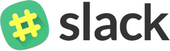

> Curadoria de Slacks no Brasil para você participar.

> **Arquivado.** Esta lista foi mantida entre 2016 e 2018 e fica aqui como registro histórico. Muitas comunidades migraram para o Discord ou fecharam, e os convites automáticos (slackin no Heroku) deixaram de existir em 2022. Onde o convite não funciona mais, a coluna Participar mostra "—".

## Desenvolvimento

### Front-end

Comunidade | Participar
---------- | ----------
Angular Brasil | —
Bootstrap Brasil | —
[Vue.js Brasil](https://vuejs-brasil.slack.com/) | —
[FrontUX Brasil](https://uxsp.slack.com/) | [Participar](https://uxsp.slack.com/signup)

### Back-end

Comunidade | Participar
---------- | ----------
Electron Brasil | —
[Laravel](https://laravel-br.slack.com) | —
[Meteor Brasil](https://meteor-brasil.slack.com/) | —
[.Net Architects](http://dotnetarchitects.slack.com/) | —
[NodeBR](http://nodebr.slack.com/) | [Participar](https://slack.nodebr.org)
[GoJava](http://gojavajug.slack.com) | —
PHPMG | —
[PHPSC](http://www.phpsc.com.br) | —
[PHPSP](http://www.phpsp.org.br) | —
[Python Brasil](https://pythonbrasil.slack.com) | —
[CakePHP Brasil](https://cakephpbrasil.slack.com) | —
[Go](https://gophers.slack.com/) | —
[Elixir](https://elixir-lang.slack.com) | —
[Ruby Talk](https://rubytalk.slack.com/) | —
[Delphi Brasil](http://delphibrasil.slack.com/) | —
[GruPy-SP](https://grupysp.slack.com/) | —
[Java MG](https://www.meetup.com/pt-BR/java-bh/) | —
Scaladores | —
[PHPBauru](https://phpbauru.slack.com) | —

### Mobile

Comunidade | Participar
---------- | ----------
Android Dev BR | [Participar](http://slack.androiddevbr.org)
[Ionic Brazil](http://ionicbrazil.slack.com/) | —
iOS Dev BR | —

### CMS
Comunidade | Participar
---------- | ----------
[Magento Br](http://magentobr.slack.com/) | —
[WordPress Brasil](http://wpbrasil.slack.com/) | —

### Organizações

Comunidade | Participar
---------- | ----------
[Acessibilidade Web Brasil](http://a11y-brazil.slack.com/) | —
[BrazilJS](http://braziljs.slack.com/) | —
Slack de Agilidade | —
[Dev IO Fortaleza](https://deviofoundation.slack.com/) | —
[Dev Mato Grosso](http://devmt.slack.com/) | —
Dev PP | —
[DevOps BR](https://devopsbr.slack.com/) | —
[Dev Paraná](http://devparana.slack.com/) | —
[Dev RJ](https://devrj.slack.com/) | [Participar](https://devrj.slack.com/)
Docker-BR | —
[Front End Brazil](http://frontendbrasil.slack.com/) | —
[FrontEnd Campinas](https://frontendcampinas.slack.com) | —
Front UX | [Participar](https://uxsp.slack.com/messages/geral/)
[React Brasil](https://react-brasil.slack.com) | —
[GDG Brasil](http://gdgbrazil.slack.com) | —
[FEMUG-ABC](https://github.com/femug-abc) | —
[grupy-df](http://grupydf.github.io/) | —
[grupy-rp](http://grupyrp.github.io/) | —
[Minas Dev](https://minasdev.org/) | —
grude-pb | —
DevIsland | —
HaskellBR | —
[WebDevBr](https://webdevbrasil.slack.com) | [Participar](https://webdevbrasil.slack.com)
[Brasil.NET](http://brasildotnet.slack.com) | [Participar](http://brasildotnet.slack.com)
[UX-BH](http://ux-bh.slack.com) | —
[QA-BR](http://qa-br.slack.com) | —
[opensanca](http://opensanca.slack.com) | —
[Training Center](https://ctgroups.slack.com) | —
[The Tech Cafe](https://thetechcafe.github.io/) | —
[Training Center](https://github.com/training-center/sobre) | —
Hack.river | —
[UX VIX](https://www.meetup.com/pt-BR/UX-Vix/) | [Participar](http://ux-es.slack.com)
Agilidade | —
Artesania de Software | —

## Empreendedorismo

Comunidade | Participar
---------- | ----------
[Cariocas](https://cariocas.slack.com/) | [Participar](https://cariocas.slack.com/)
[Carreira Solo](https://carreirasolo-org.slack.com/) | [Participar](https://carreirasolo-org.slack.com/)
[Startup Brasil](http://supbra.slack.com/) | —
[Startup PE](http://startupe.slack.com) | —
[Startup Study Group](http://ssg-slack.slack.com) | —
Vale do Chimarrão | [Participar](https://valedochimarrao.slack.com/)
[Startupeiros de Brasilia](https://startupeiro.slack.com/) | —
## Gringos

Comunidade | Participar
---------- | ----------
[WordPress](https://wordpress.slack.com/) | [Participar](https://make.wordpress.org/chat/)
[Ionic Worldwide](https://ionic-worldwide.slack.com/) | —
[FrontEnd Developers](https://feds.slack.com/) | —
[AMP HTML](https://amphtml.slack.com/) | [Participar](https://docs.google.com/forms/d/e/1FAIpQLSd83J2IZA6cdR6jPwABGsJE8YL4pkypAbKMGgUZZriU7Qu6Tg/viewform?fbzx=4406980310789882877)
[Laravel](https://larachat.co/) | [Participar](https://larachat.co/join)
[iOS Developers](http://ios-developers.io) | [Participar](http://ios-developers.io)
[MongoDB Community](https://mongo-db.slack.com) | [Participar](https://mongo-db.slack.com)

## Outros

Comunidade | Participar
---------- | ----------
Estratégias de Investimento | [Participar](https://docs.google.com/forms/d/17OecElQDB9Fyt56bKQMDdvmwQZnnpQPBFzUOrTDgZJ0/viewform?c=0&w=1)
nacafeteria | —
